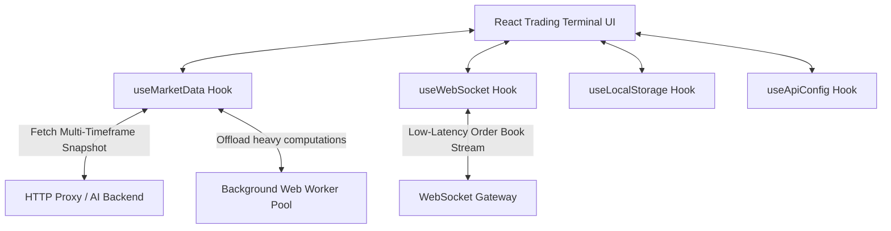

# Intelligence Trader — IME AI Terminal

The client dashboard for the Intelligences-Trader ecosystem, built with **React**, **TypeScript**, **Vite v7**, and **TailwindCSS v4**.

> **Scope:** this workspace is a research/simulation terminal. Market data comes from the digital twin
> (simulation) by default and is labelled as such in the UI; there is no broker/OMS and no live order
> routing.

---

## 📂 Directory Layout

```
robot trader/
├── dist/                  # Built static production distribution assets
├── server/                # AI and Quant Analysis Backend (TensorFlow.js / ONNX)
├── src/
│   ├── components/
│   │   ├── analytics/     # OrderBook, SentimentMonitor, ArbitragePanel, MarketCorrelation,
│   │   │                  # MarketRegimeTimeline, LearningDashboard, PerformanceAnalytics,
│   │   │                  # FullPaperTradingDashboard, BacktestingDashboard
│   │   ├── charts/        # ProfessionalChart
│   │   ├── common/        # Shared primitives: Card, Badge, Button, StatusDot, Gauge, Empty,
│   │   │                  # Alert, Modal, Skeleton (+ the useModalFocus hook)
│   │   ├── dashboard/     # TradeTicket, RiskControlPanel, SystemHealthMonitor, AISignal,
│   │   │                  # ApiSettingsPanel, KPI (MetricCard)
│   │   └── layout/        # AppShell: Header, Sidebar, MobileDrawer, BottomNav, StatusBar
│   ├── dataUtils.ts       # Indicators, regime rules, synthetic feed helpers
│   ├── hooks/             # useMarketData, useWebSocket, useLocalStorage, useApiConfig
│   ├── services/          # apiFetch, BackendApiService, PredictionHistoryService, LearningEngine
│   ├── types.ts           # Shared domain types
│   ├── constants.ts       # Symbols, default API config, initial metrics, default risk limits
│   ├── App.tsx            # Application container: tab routing, risk engine, order execution
│   ├── index.css          # Tailwind CSS v4 design tokens and global styles
│   └── main.tsx           # React entry point
├── tests/                 # Playwright integration and behavioral tests
├── tsconfig.json          # TypeScript workspace compiler settings
└── vite.config.ts         # Vite build configuration with Tailwind CSS v4 plugin
```

---

## 🏗 Component & Hook Architecture

The client application separates business logic from presentational elements using a modular custom hook architecture:



### 1. **Core Custom Hooks (`/src/hooks`)**
- `useMarketData`: Orchestrates batch data fetching across multiple timeframes, manages analysis dispatching to workers/backend, and tracks model training states. Falls back to the labelled digital-twin feed when the live feed is unavailable.
- `useWebSocket`: Manages low-latency real-time streams for Level 2 Order Books and price action ticks, featuring exponential backoff reconnection logic.
- `useLocalStorage`: Handles state persistence for user balances, open trades, and custom risk parameters.
- `useApiConfig`: Persists and validates the backend/proxy configuration (base URLs, API key, digital-twin toggle).

### 2. **Component Structure**
- **Dashboard Modules (`/components/dashboard`)**: Execution and operator panels — `TradeTicket` (order entry), `RiskControlPanel` (limits, circuit breakers, kill switch), `SystemHealthMonitor` (session/worker status), `AISignal` (forecast summary), `ApiSettingsPanel` (backend connection + sign-in), `KPI` (`MetricCard`).
- **Analytics Panels (`/components/analytics`)**: Order-book depth, sentiment, correlation, arbitrage (simulation-labelled), rule-based regime classification, learning, paper-trading and backtesting views.
- **Charts (`/components/charts`)**: `ProfessionalChart` (lightweight-charts wrapper).
- **Common Primitives (`/components/common`)**: `Card`, `Badge`, `Button`, `StatusDot`, `Gauge`, `Empty`, `Alert`, `Modal`, `Skeleton`.

---

## 🎨 Design System: "Cybernetic Quant"

The visual language is defined by the Tailwind CSS v4 tokens in `src/index.css`:
- **Surfaces:** layered dark panels (`--color-surface`, `--color-surface-container*`) with subtle backdrop blur and drop shadows.
- **Typography:** Inter / Plus Jakarta Sans for UI text, JetBrains Mono / Fira Code for numeric and terminal readouts, Vazirmatn for Farsi text.
- **State-aware Highlights:** Color channels correspond to system states:
  - <span style="color:#10b981">**Emerald (Growth/Buy):**</span> Upward momentum, active profit, and positive sentiment.
  - <span style="color:#ef4444">**Crimson (Risk/Sell):**</span> Downward pressure, stop-loss warnings, and sell signals.
  - <span style="color:#f59e0b">**Amber (Caution):**</span> Connectivity alerts, extreme volatility warnings, or shadow-mode deviation anomalies.
  - <span style="color:#00f0ff">**Telemetry Cyan:**</span> Live values, active telemetry, and focus indicators.

---

## 🔬 Performance & Worker Offloading

Heavy analysis is kept off the UI thread, but the implementation is narrower than a "zero-copy" pipeline:

- **Web Worker Pool:** `src/workers/workerPool.ts` dispatches queued jobs across idle workers and replaces failed workers. The analysis worker runs `analyzeMarketMTF`, `performWalkForwardBacktest` and `trainModelEpoch` (see `src/workers/marketAnalyzer.worker.ts`).
- **Message passing:** results travel through `postMessage`, i.e. the structured clone algorithm — the payload is copied, not shared.
- **Optional atomics path:** the worker accepts an optional `sharedBuffer` payload and uses `Atomics.compareExchange` as a race-condition demonstration; the application does not currently run a shared-memory pipeline, and no `Float64Array` price-series buffer is used.
- **Main-thread parsing:** WebSocket message parsing still runs on the main thread; only the analysis computations above are offloaded.

---

## 🧪 Tests

```bash
npm run typecheck            # strict TypeScript
npm test                     # node --test suite (50 cases, including the orphan-module guard)
npm run build                # production bundle
npm run test:e2e             # Playwright browser journeys (desktop + mobile)
```

The orphan-module guard (`src/orphanGuard.test.ts`) asserts that every production module under `src/` is
reachable from the entry points; it fails `npm test`, not `npm run build`.
