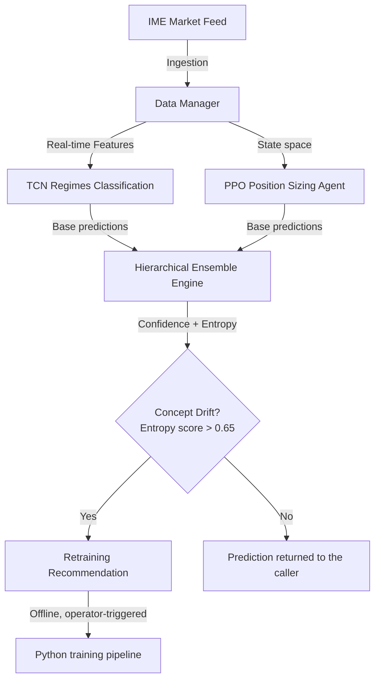

# AI & Quant Analysis Backend

The core intelligence layer of the Intelligences-Trader ecosystem, powered by **TensorFlow.js**, **ONNX Runtime**, and **Node.js**.

> **Scope:** research and simulation. The advanced engines below are deterministic, seeded
> simulations used for wiring and regression tests — they are not connected to a live broker,
> a licensed feed, or a production training pipeline.

---

## 🧠 Model Architectures & Mathematical Frameworks

### 1. Temporal Convolutional Network (TCN)
Used for time-series sequence classification to identify trend direction and market regimes across multiple timeframes (`tcnModel.js`).
- **Dilated Causal Convolutions:** Ensures predictions at time step \(t\) only depend on past states. The dilated causal convolution operator is defined as:
  \[y(t) = (x * _d f)(t) = \sum_{i=0}^{k-1} f(i) \cdot x(t - d \cdot i)\]
  where \(f\) is the filter of size \(k\), \(d\) is the dilation factor, and \(x(t - d \cdot i)\) enforces temporal causality. The implementation uses left-only zero padding (`dilationRate` 1/2/4/8) so no future step leaks into the activation.
- **Focal Loss Function (`focalLoss(alpha, gamma)`):** Addresses class imbalance by down-weighting easy-to-classify samples:
  \[FL(p_t) = -\alpha_t (1 - p_t)^\gamma \log(p_t)\]
  where \(\gamma \ge 0\) is the focusing parameter and \(\alpha_t\) is the class-balancing factor.
- **Expected Calibration Error (ECE):** `calculateCalibrationError` in `index.js` is reported by `POST /api/train` from the measured holdout predictions — it is not a stored constant:
  \[ECE = \sum_{m=1}^{M} \frac{|B_m|}{N} \left| acc(B_m) - conf(B_m) \right|\]
  where \(B_m\) represents the samples in the \(m\)-th confidence bin, and \(N\) is the total sample count.

---

### 2. PPO Reinforcement Learning Agent
The Python research pipeline (`ml_service/train.py`, `ml_service/models.py`) trains a policy with a categorical direction head and a Beta position-size head, simulating Kelly-style sizing mechanics.
- **Clipped Surrogate Objective:** Prevents destabilizing policy updates in volatile regimes:
  \[L^{CLIP}(\theta) = \hat{\mathbb{E}}_t \left[ \min\left(r_t(\theta)\hat{A}_t, \, \text{clip}(r_t(\theta), 1-\epsilon, 1+\epsilon)\hat{A}_t\right) \right]\]
  where \(r_t(\theta) = \frac{\pi_\theta(a_t|s_t)}{\pi_{\theta_{old}}(a_t|s_t)}\) is the probability ratio, \(\hat{A}_t\) is the GAE-λ advantage estimate, and \(\epsilon = 0.2\) is the clipping parameter.
- **Entropy Bonus Adjustment:** Integrates policy entropy \(\mathcal{H}\) into the loss function to encourage exploration of the continuous size action space:
  \[L^{PPO}(\theta) = L^{CLIP}(\theta) + 0.5\,L^{VF}(\theta) - 0.01\,\mathcal{H}(\pi_\theta(\cdot|s_t))\]

---

### 3. Hierarchical Ensemble Engine
`ensembleEngine.js` fuses five base signals (`tcn`, `lstm`, `xgboost`, `randomForest`, `linear`) and re-weights them from observed outcomes.
- **Softmax Attention Fusing:** Dynamically weights base model predictions:
  \[w_j = \frac{e^{score_j / \tau}}{\sum_{k} e^{score_k / \tau}}\]
- **Adaptive Temperature Scaling:** the temperature \(\tau\) is derived at inference time from the spread of the tracked per-model performance values and clamped to `[0.1, 1.0]`.
- **Reality check:** the base predictions in this workspace are *seeded, deterministic placeholders* (`generateBasePredictions` derives them from a seeded RNG and a feature hash), not live inference from trained TCN/LSTM/gradient-boosted models. The softmax weighting, correlation matrix and outcome-driven weight updates are real code paths.

---

## 📡 Advanced Frameworks

### Federated Learning (FedAvg)
`federatedEngine.js` implements a FedAvg-style aggregation loop exposed at `POST /api/advanced/federated/round`.
- **Aggregation Formula with Differential Privacy:**
  \[w_{t+1} = \sum_{k=1}^{K} \frac{n_k}{n} (w_t^k + \eta \Delta w_t^k + \mathcal{N}(0, \sigma^2 I))\]
  where \(\mathcal{N}(0, \sigma^2 I)\) is the Gaussian noise vector injected to guarantee privacy boundaries.
- **Reality check:** the five "clients" are local placeholders. Each client update is a seeded pseudo-gradient (`clientUpdate`), not the output of a real decentralized training run, and the round metrics (`communicationEfficiency`, `performanceDrop`) are static strings rather than measurements.

### Explainable AI (XAI)
`xaiEngine.js` exposes `POST /api/advanced/xai` and returns SHAP-style contributions, LIME-style local weights and attention weights.
- **SHAP (Shapley Additive Explanations):** Explains model prediction deltas using Shapley values:
  \[\phi_i(v) = \sum_{S \subseteq F \setminus \{i\}} \frac{|S|!(|F| - |S| - 1)!}{|F|!} \left( v(S \cup \{i\}) - v(S) \right)\]
  where \(F\) is the complete set of features, \(S\) is the subset of features excluding index \(i\), and \(v(S)\) is the characteristic value function.
- **Reality check:** `calculateSHAP` is a deterministic approximation — per-feature impacts are derived from seeded weights and then rescaled so they sum to the prediction delta — not an exact Shapley enumeration over feature subsets.

---

## 📈 MLOps & Retraining Pipeline

The server monitors concept drift and **recommends** an offline retraining run. It does not retrain or
hot-swap models on the request path.



- **Concept Drift Detection:** `modelManager.monitorDrift` smooths the normalized prediction entropy with an EMA and reports `detected: true` once at least 30 samples have been observed and the score exceeds the threshold (0.65).
- **Recommendation, not automation:** when drift is detected the response carries `retrainRecommended: true` and a warning is logged ("offline retraining is recommended"). No model version is fabricated and no weights are regenerated in-process.
- **Hot reload:** `modelManager.hotReload(newModelPath, newVersion)` can swap an ONNX artifact in memory, but it has no caller in the current request path — it is a maintenance entry point, not a zero-downtime retraining loop.

---

## 🧪 Tests

```bash
npm test --workspace robot trader/server
```

The workspace runs 151 cases, including the P2 execution, chaos, ledger, authentication and model-contract suites.
